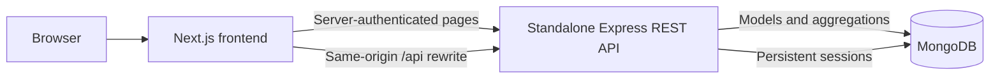
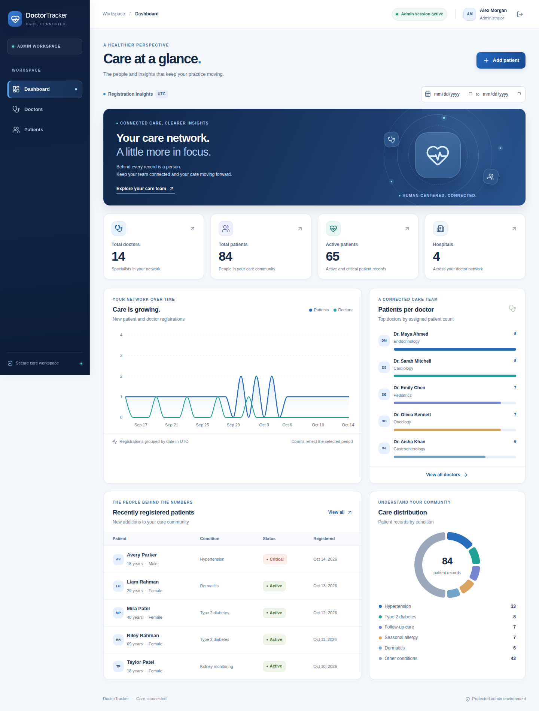
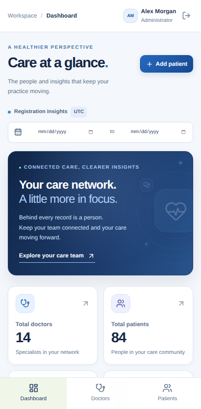
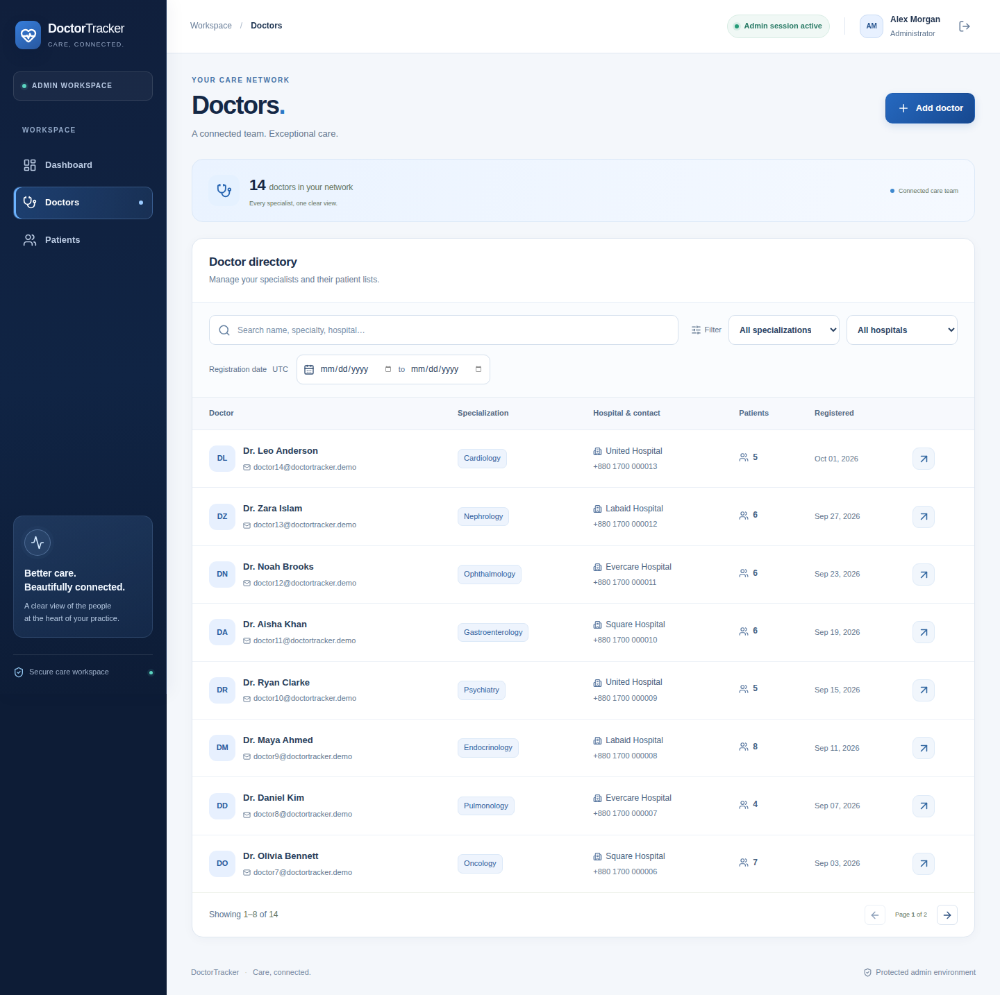
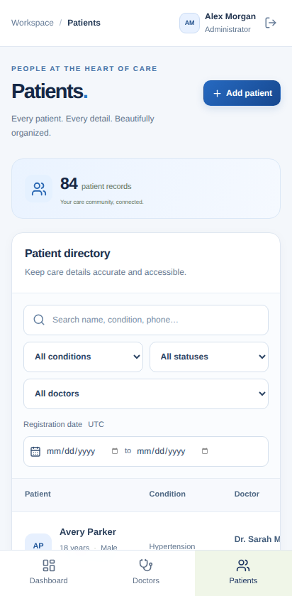

# Doctor-Tracker-Portal

A responsive administrative portal for managing doctors, their patients, and care activity. The application pairs a Next.js frontend with a separate Express REST API and MongoDB, with authenticated access, searchable directories, patient management, and database-backed analytics.

## Features

- Secure administrator login, persistent sessions, logout, and protected pages/APIs.
- Doctor creation and directory with search, specialization/hospital/date filters, and pagination.
- Doctor profiles with assigned patients and patient creation/deletion.
- Patient directory with editing, deletion, search, doctor/condition/status/date filters, and pagination.
- Dashboard totals, registration trends, patient distribution by doctor/condition, and recent records.
- Responsive interface with accessible forms/dialogs, keyboard navigation, reduced motion, and clear loading/empty/error states.

## Repositories

| Application      | Repository                                             | Local directory |
| ---------------- | ------------------------------------------------------ | --------------- |
| Next.js frontend | https://github.com/sajeeb-ahmeed/Doctor-Tracker-Portal | Workspace root  |
| Express backend  | https://github.com/sajeeb-ahmeed/Doctor-Tracker-API    | `backend/`      |

`backend/` is an independent Git repository and is excluded from the frontend repository. The setup script clones it when missing.

## Local installation

### Prerequisites

- Node.js 24 and npm.
- Git and internet access for package installation and the first MongoDB binary download.
- Windows, macOS, or Linux supported by MongoDB's development binary.

```bash
git clone https://github.com/sajeeb-ahmeed/Doctor-Tracker-Portal.git
cd Doctor-Tracker-Portal
npm ci
npm run setup:local
npm run dev:all
```

The setup script preserves existing environment files, installs backend dependencies, creates `.env.local` from the frontend example, and creates `backend/.env` with a random session secret and local-only demo settings. It enables both localhost and 127.0.0.1 frontend origins.

Open **http://127.0.0.1:3000**. The API health endpoint is **http://127.0.0.1:4000/api/health**. On first launch, the backend downloads and starts a real MongoDB development process and seeds synthetic records. MongoDB data persists in the backend's ignored `.data/` directory across restarts.

### Demonstration login

| Field    | Development value          |
| -------- | -------------------------- |
| Email    | `admin@doctortracker.demo` |
| Password | `DoctorDemo!2030`          |

These credentials are for synthetic local demonstration data. Production credentials are configured separately in the backend environment.

### Run services separately

```bash
# Terminal 1
cd backend
npm run dev:local

# Terminal 2: frontend repository root
npm run dev
```

For an existing MongoDB installation, set `MONGODB_URI=mongodb://127.0.0.1:27017/doctor_tracker` in `backend/.env`. The automatic local launcher is only used in development when that value is blank. See the backend README for Docker and production configuration.

### Environment variables

The frontend `.env.example` contains one server-only setting:

| Variable      | Purpose                                                                                                                     |
| ------------- | --------------------------------------------------------------------------------------------------------------------------- |
| `BACKEND_URL` | Express server origin, without `/api`; used by server-side authentication and API rewrites. Required for production builds. |

The backend `.env.example` documents MongoDB, permitted frontend origins, administrator credentials, session secret, port, and synthetic seeding. Do not commit environment files.

## System architecture



The browser requests `/api/*` on the frontend origin. Next.js forwards these requests to the separately deployed Express server. All business logic, authorization, validation, data access, and aggregation are in Express. The portal layout validates the session on the server before rendering protected pages; API endpoints independently enforce administrator authorization.

React Query manages server data, query keys, loading states, and mutation invalidation. Form input and temporary UI state stay local to their components. The browser does not receive database credentials or the backend environment.

## Technical decisions

### 1. Same-origin API forwarding with persistent server-side sessions

Separate frontend and backend hosting commonly introduces cross-site cookie behavior. A Next.js rewrite gives the browser a consistent frontend origin while keeping the backend as a standalone REST service. Express stores sessions in MongoDB and sends an HttpOnly cookie; the frontend never handles a reusable session token in JavaScript. Production uses HTTPS-only cookies, allowed-origin checks, and a required custom mutation header.

Both the server-rendered layout and Express verify authentication. Hiding controls alone would not protect data. The tradeoff is one forwarding hop and the need to update `BACKEND_URL` at build time; those deployment steps are documented.

### 2. Database-side queries and server-data caching

Directories request only a bounded page with server-side search and filters. Totals are counted against the same filter, and sorting uses creation date plus an ID tie-breaker. MongoDB indexes support the main filtering/sorting patterns; dashboard results are computed from persisted records rather than static frontend arrays. The backend README describes index choices, search behavior, pagination limits, and scaling tradeoffs.

React Query caches responses by their filter parameters. Successful mutations call `invalidateQueries()` across the cached queries: active queries refetch immediately, and inactive queries become stale for their next use. This keeps lists, metadata, profiles, and dashboard data consistent after changes. The broad invalidation is simple for this small portal; more selective query keys would reduce refetching as the application grows. Server records stay in the query cache rather than a second global state store, while form input stays local to each component.

## Project structure

```text
app/                 App Router pages and protected portal layout
components/          Navigation, forms, dialogs, tables, charts, UI primitives
lib/                 API client, response types, hooks, utilities
tests/               Desktop/mobile browser workflows and API smoke tests
scripts/             Cross-platform local setup and combined service launcher
docs/                Deployment instructions, screenshots, validation record
backend/             Separate Express/MongoDB repository (ignored here)
```

## Verification

With both services running:

```bash
npm run typecheck
npm run build
npx playwright install chromium
npm run test:e2e

cd backend
npm run check
npm run build
npm test
```

Browser tests cover anonymous access, invalid credentials, persistent doctor/patient workflows, combined filters, pagination, dashboard changes, logout/API authorization, and mobile navigation/overflow. Backend tests use a separate test database. Browser tests create uniquely named synthetic doctors because deleting doctors is outside the specified scope; they should run against a development/test database.

Formatting: `npm run format` and `npm run format:check`. CI runs type checking and a production frontend build. Detailed outcomes are recorded in `docs/VALIDATION.md` after verification. The [requirements checklist](docs/REQUIREMENTS_CHECKLIST.md) maps the PDF and submission email to source, tests, and documentation evidence, including outstanding delivery items.

## Visual evidence

### Desktop dashboard



### Mobile dashboard



### Doctor directory



### Mobile patient directory



## Scope and data definitions

- One administrator role; public registration, appointments, and doctor editing/deletion are outside the required scope.
- Each patient belongs to one doctor. Patients have a name, age, gender, condition, status, phone, and optional email.
- Date filters use record creation dates; `from` and `to` include the entire specified UTC day. Charts describe registrations, not appointments or treatment outcomes.
- Deleting a patient permanently removes that record from the doctor's list, patient directory, and related analytics.
- Demonstration people and contact details are synthetic.

## Deployment and submission

### Publicly hosted DoctorTracker demo (14 October 2026)

- **Frontend:** <https://doctor-tracker-frontend.onrender.com/login> (Render Free)
- **Backend API:** <https://doctor-tracker-api-tg86.onrender.com/api/health> (Render Free)
- **Database:** MongoDB Atlas, database `doctor_tracker`, synthetic demonstration records
- **Public smoke test:** [GitHub Actions verification](https://github.com/sajeeb-ahmeed/Doctor-Tracker-Portal/actions/runs/38557792623)

The live smoke test verified the login page, database-backed API, same-origin API forwarding,
anonymous route protection and invalid-login handling. Authenticated production CRUD
still requires a manual check with the private administrator password. The previously reserved
Netlify address does not currently host the application; use the verified Render frontend URL.

See `docs/DEPLOYMENT.md` for separate backend/frontend deployment and end-to-end acceptance checks. The frontend includes `netlify.toml`; the backend includes a Render blueprint. Production requires hosted MongoDB and hosting environment configuration.

The submission should include both GitHub repositories, both live service URLs, and a demonstration login, using Reply All to the original assignment email. Local URLs do not count as public deployment URLs.
